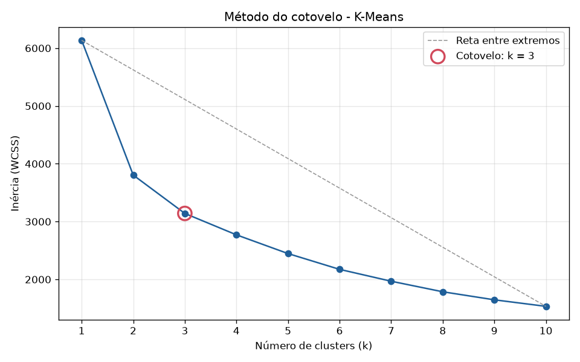
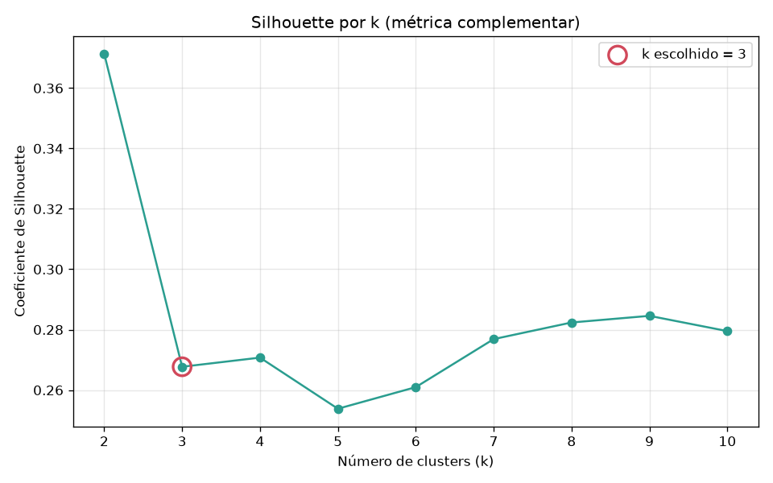
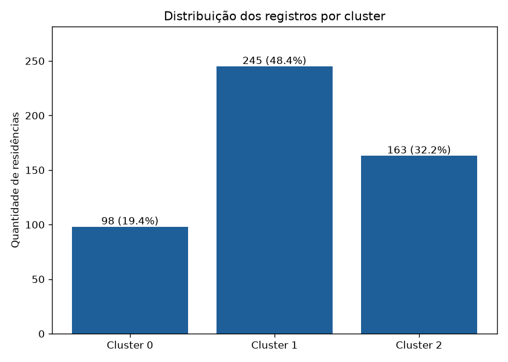

# Boston Housing — Clusterização com K-Means

Projeto de clusterização não supervisionada que agrupa regiões residenciais da base
**Boston Housing** em perfis semelhantes usando **K-Means**. Ele está dividido em dois módulos:

- **Treinamento** (`python -m src.train`): trata e normaliza a base, escolhe o número de grupos
  pelo método do cotovelo, treina o modelo e salva o pipeline completo.
- **Inferência** (`python -m src.inference`): recebe uma nova residência, aplica o mesmo
  pré-processamento, informa o cluster atribuído e mostra o centroide **na escala original**.

Todos os números deste documento vêm da execução real do projeto (`random_state = 42`).

---

## Tecnologias

| Biblioteca | Versão | Uso |
|---|---|---|
| Python | 3.14 | Linguagem |
| scikit-learn | 1.9.1 | `Pipeline`, `ColumnTransformer`, `SimpleImputer`, `StandardScaler`, `OneHotEncoder`, `KMeans`, `silhouette_score` |
| pandas | 3.1.1 | Leitura e manipulação dos dados |
| numpy | 2.5.4 | Cálculos numéricos |
| matplotlib | 3.11.2 | Gráficos |
| joblib | 1.6.0 | Persistência do modelo |
| pytest | 9.2.0 | Testes automatizados |

---

## Estrutura de diretórios

```
boston-housing-kmeans/
├── data/
│   └── HousingData.csv            # base original (506 x 14)
├── models/
│   └── kmeans_pipeline.joblib     # pré-processador + K-Means + metadados
├── reports/
│   ├── elbow_method.png           # gráfico do cotovelo
│   ├── elbow_results.csv          # inércia, silhouette e redução % para k = 1..10
│   ├── silhouette_scores.png      # métrica complementar
│   ├── cluster_distribution.png   # registros por cluster
│   └── cluster_centroids.csv      # centroides na escala original
├── src/
│   ├── config.py                  # caminhos, features, hiperparâmetros
│   ├── preprocessing.py           # leitura, pipeline de transformação, validação, desnormalização
│   ├── train.py                   # módulo de treinamento
│   └── inference.py               # módulo de inferência (JSON e interativo)
├── tests/
│   └── test_pipeline.py           # 32 testes pytest
├── examples/
│   └── nova_residencia.json       # entrada de demonstração
├── pytest.ini
├── requirements.txt
└── README.md
```

---

## A base de dados

**506 registros, 14 colunas e nenhum registro duplicado.**

| Variável | Descrição | Tipo adotado |
|---|---|---|
| CRIM | Taxa de criminalidade per capita | Quantitativa |
| ZN | % de terrenos residenciais com lotes > 25.000 pés² | Quantitativa |
| INDUS | % de área de comércio não varejista | Quantitativa |
| **CHAS** | Margeia o rio Charles (0/1) | **Categórica binária** |
| NOX | Concentração de óxidos nítricos | Quantitativa |
| RM | Nº médio de cômodos | Quantitativa |
| AGE | % de imóveis construídos antes de 1940 | Quantitativa |
| DIS | Distância ponderada a centros de emprego | Quantitativa |
| **RAD** | Índice de acesso a rodovias radiais | **Numérica discreta** |
| TAX | Imposto predial por US$ 10.000 | Quantitativa |
| PTRATIO | Razão aluno/professor | Quantitativa |
| B | 1000(Bk − 0,63)² | Quantitativa |
| LSTAT | % da população de baixa renda | Quantitativa |
| **MEDV** | Valor mediano das residências (US$ 1.000) | **Alvo — fora da clusterização** |

### Achados da análise exploratória

- **Valores ausentes:** 20 em cada uma das colunas CRIM, ZN, INDUS, CHAS, AGE e LSTAT (120 no
  total). Eles afetam **112 linhas (22% da base)**, então descartá-las perderia muita informação.
- **CHAS:** 452 zeros, 34 uns e 20 ausentes. A variável é binária e bastante desbalanceada.
- **RAD:** assume apenas 9 valores (1–8 e 24); 132 registros têm RAD = 24.
- **Valores extremos (critério IQR):** CRIM tem 65 registros atípicos e assimetria de 5,21
  (mediana 0,25; máximo 88,98); B tem 77; ZN tem 63; RM tem 30.

### Decisões sobre as variáveis

- **MEDV fica fora das features.** O módulo de inferência classifica uma *nova* residência a
  partir das suas características, e o valor de mercado normalmente é justamente o que não se
  conhece nesse momento. Usar MEDV no treino criaria uma dependência que a inferência não
  conseguiria cumprir. Ainda assim, a média de MEDV de cada cluster é calculada **depois** do
  treino, apenas como informação descritiva.
- **CHAS é tratada como categórica.** Ela é um indicador (sim/não), não uma grandeza contínua.
  Por isso recebe imputação pela moda e One-Hot Encoding, sem padronização.
- **RAD é tratada como numérica discreta.** O índice é ordinal (valores maiores indicam maior
  acessibilidade). Codificá-lo com One-Hot criaria 9 colunas esparsas e aumentaria
  artificialmente o peso dessa variável na distância euclidiana. Ela é padronizada como as demais
  quantitativas, e a validação exige um valor inteiro na entrada.
- **Valores extremos não são removidos.** Eles são casos reais (regiões de alta criminalidade) e
  formam boa parte de um dos perfis. Uma limitação conhecida: o `StandardScaler` não é robusto a
  outliers, então CRIM e B influenciam a escala. Esse efeito fica concentrado no cluster urbano
  (ver resultados).

---

## Pré-processamento

O pré-processamento é um `ColumnTransformer` dentro de um `Pipeline` do scikit-learn:

| Grupo | Variáveis | Etapa 1 | Etapa 2 |
|---|---|---|---|
| Quantitativas | CRIM, ZN, INDUS, NOX, RM, AGE, DIS, RAD, TAX, PTRATIO, B, LSTAT | `SimpleImputer(strategy="median")` | `StandardScaler()` |
| Categórica | CHAS | `SimpleImputer(strategy="most_frequent")` | `OneHotEncoder()` → `CHAS_0.0`, `CHAS_1.0` |

- **Mediana** em vez de média: as variáveis com ausentes são assimétricas. Em CRIM, a média é
  3,61 e a mediana é 0,25, então imputar pela média deslocaria os registros para valores atípicos.
- **Moda** para CHAS: a categoria mais frequente é 0.
- **Não há balanceamento**: em clusterização não existe classe-alvo a balancear.
- **O pré-processador é ajustado uma única vez** no treinamento e salvo junto com o K-Means. Na
  inferência ele é apenas reutilizado (`transform`), nunca reajustado, então medianas, médias e
  desvios são sempre os aprendidos na base de treino. A ordem e os nomes das features são fixos
  em `src/config.py`, e o carregamento do modelo confere se eles batem.

Após a transformação, cada registro tem **14 dimensões**: 12 quantitativas padronizadas e 2
colunas one-hot de CHAS.

---

## Por que K-Means

- O problema é não supervisionado: queremos descobrir perfis de regiões sem rótulos prévios.
- Com todas as features numéricas e padronizadas, a distância euclidiana usada pelo K-Means é
  adequada.
- Os centroides são diretamente interpretáveis como o **perfil médio** de cada grupo.
- O método `predict` atribui novas residências ao centroide mais próximo, que é exatamente o que
  o módulo de inferência precisa.

---

## Método do cotovelo e escolha de k

O K-Means foi executado para **k = 1 a 10** (`n_init = 10`, `random_state = 42`), e para cada k
foi registrada a **inércia (WCSS)**: a soma das distâncias quadráticas de cada ponto ao seu
centroide.

| k | Inércia (WCSS) | Redução vs. k−1 | Silhouette |
|---:|---:|---:|---:|
| 1 | 6.135,431 | — | — |
| 2 | 3.804,498 | 37,99% | **0,371** |
| **3** | **3.141,445** | **17,43%** | **0,268** |
| 4 | 2.771,358 | 11,78% | 0,271 |
| 5 | 2.447,405 | 11,69% | 0,254 |
| 6 | 2.173,975 | 11,17% | 0,261 |
| 7 | 1.968,775 | 9,44% | 0,277 |
| 8 | 1.786,226 | 9,27% | 0,282 |
| 9 | 1.647,267 | 7,78% | 0,285 |
| 10 | 1.534,285 | 6,86% | 0,280 |



**Como o cotovelo é identificado:** a curva de inércia é normalizada em [0, 1] nos dois eixos, e
o cotovelo é o k cujo ponto fica mais distante da reta que liga k = 1 a k = 10 (a linha tracejada
no gráfico). Essa regra é objetiva e reproduzível (função `find_elbow_k` em `src/train.py`).

**Resultado: k = 3.** As duas primeiras divisões geram ganhos grandes (−38,0% e −17,4% de
inércia). A partir de k = 4, cada cluster adicional reduz a inércia em um ritmo praticamente
constante (11,8% → 11,7% → 11,2% → 9,4%…), o que mostra retornos decrescentes.

### Silhouette como métrica complementar



O Silhouette mais alto ocorre em **k = 2 (0,371)**. Analisando o que esse k = 2 separa, porém, a
divisão é pouco informativa: um grupo de 176 registros (75% com RAD = 24 e imposto médio 608)
contra todo o restante (330 registros). O k = 3 mantém esse grupo urbano e **divide o restante em
dois perfis bem diferentes**: suburbano de lotes grandes (ZN médio 48) e intermediário (ZN médio
3). Entre k = 3 e k = 4 o Silhouette é praticamente igual (0,268 vs. 0,271), sem motivo para
aumentar k. Portanto, o Silhouette não contradiz o cotovelo, e **k = 3** é mantido.

---

## Treinamento

1. Lê `data/HousingData.csv` e separa as 13 features de MEDV.
2. Ajusta o pré-processador e calcula inércia e Silhouette para k = 1..10.
3. Detecta o cotovelo e gera `elbow_method.png`, `silhouette_scores.png` e `elbow_results.csv`.
4. Treina o pipeline definitivo `[preprocessor → KMeans(n_clusters=3, n_init=10, random_state=42)]`.
5. Calcula os perfis dos clusters, gera `cluster_centroids.csv` e `cluster_distribution.png`.
6. Salva tudo em **`models/kmeans_pipeline.joblib`**: o pipeline ajustado, a lista de features, o
   k escolhido, os perfis dos clusters, os resultados do cotovelo, as faixas observadas de cada
   variável, a versão do scikit-learn e a data do treino.

O treinamento é determinístico: executá-lo de novo produz os mesmos centroides (há um teste
automatizado para isso).

### Resultados obtidos



Centroides na **escala original** (`reports/cluster_centroids.csv`, valores arredondados):

| Variável | Cluster 0 | Cluster 1 | Cluster 2 |
|---|---:|---:|---:|
| Residências | 98 (19,4%) | 245 (48,4%) | 163 (32,2%) |
| CRIM | 0,084 | 0,382 | 10,175 |
| ZN | 48,10 | 3,00 | 0,00 |
| INDUS | 4,03 | 8,92 | 18,41 |
| CHAS (predominante) | 0 (94,9%) | 0 (92,7%) | 0 (93,3%) |
| NOX | 0,426 | 0,519 | 0,685 |
| RM | 6,685 | 6,341 | 5,959 |
| AGE | 32,15 | 69,28 | 90,26 |
| DIS | 6,752 | 3,811 | 1,993 |
| RAD | 4,20 | 4,54 | 20,29 |
| TAX | 301,0 | 305,1 | 627,7 |
| PTRATIO | 17,02 | 18,16 | 19,76 |
| B | 389,45 | 382,85 | 297,62 |
| LSTAT | 6,57 | 11,14 | 18,63 |
| Distância média dos membros | 2,031 | 2,090 | 2,736 |
| *MEDV médio (informativo)* | *28,65* | *24,28* | *16,23* |

**Interpretação dos perfis:**

- **Cluster 0 — suburbano residencial (98):** baixa criminalidade, muitos lotes grandes (ZN 48),
  pouca indústria, ar mais limpo, imóveis mais novos (AGE 32) e longe dos centros de emprego
  (DIS 6,8). Tem a menor proporção de baixa renda e o maior valor médio (US$ 28,7 mil).
- **Cluster 1 — intermediário (245):** o grupo mais numeroso. Todos os indicadores ficam em
  valores médios, e o valor médio é de US$ 24,3 mil.
- **Cluster 2 — urbano/industrial (163):** criminalidade alta (CRIM 10,2), forte presença
  industrial, poluição (NOX 0,69), imóveis antigos, perto dos centros (DIS 2,0), acesso máximo a
  rodovias (RAD ≈ 20) e imposto elevado (TAX 628). Tem a maior proporção de baixa renda (18,6%) e
  o menor valor médio (US$ 16,2 mil). É também o grupo mais disperso (distância média 2,74).

Embora MEDV **não** tenha participado do treino, os três clusters ficaram ordenados por valor de
mercado. Isso indica que os grupos capturam diferenças socioeconômicas reais.

CHAS não diferencia os grupos (a categoria 0 predomina em todos, com 92–95%). Isso é coerente com
a variável ter apenas 7% de valores 1 na base.

> **Os centroides são perfis médios**, não residências reais. Um centroide pode ter, por exemplo,
> RAD = 4,54, um valor que nenhuma residência possui. Ele descreve o "centro de gravidade" do
> grupo.

---

## Inferência

A inferência é independente do treinamento: ela só carrega `models/kmeans_pipeline.joblib`.

1. **Recebe** os dados por arquivo JSON (uma residência ou uma lista) ou pelo terminal.
2. **Valida** a entrada: as 13 features são obrigatórias e precisam ser numéricas e finitas; CHAS
   deve ser 0 ou 1; RAD deve ser inteiro; percentuais ficam em [0, 100]; B fica em [0; 396,9];
   nenhuma variável pode ser negativa; campos desconhecidos são recusados. Todos os erros são
   listados de uma vez.
3. **Transforma** com o pré-processador salvo: padroniza as quantitativas com as médias e
   desvios do treino e aplica o One-Hot em CHAS.
4. **Classifica** com `KMeans.predict`.
5. **Recupera** o centroide do cluster atribuído.
6. **Desnormaliza** o centroide:
   - quantitativas: `StandardScaler.inverse_transform`, que devolve a escala original;
   - CHAS: cada coordenada one-hot do centroide é a **proporção de membros** naquela categoria.
     O sistema mostra a categoria predominante e o seu percentual, em vez de uma "média" como
     0,07 que não corresponde a nenhuma categoria real.
7. **Calcula** a distância euclidiana da residência ao centroide (no espaço normalizado) e a
   compara com a distância média dos membros do cluster e com o segundo cluster mais próximo.

Avisos adicionais:

- Se MEDV for enviado, ele é **ignorado**, com um aviso.
- Se algum valor estiver fora da faixa observada na base de treino (ex.: PTRATIO = 40), o sistema
  ainda classifica, mas alerta que a atribuição pode ser pouco representativa.

### Exemplo real de execução

Entrada `examples/nova_residencia.json` (dados **fictícios**, só para demonstração):

```json
{
  "id": "exemplo_demonstracao_001",
  "CRIM": 0.25, "ZN": 12.5, "INDUS": 7.0, "CHAS": 0, "NOX": 0.52, "RM": 6.4,
  "AGE": 65.0, "DIS": 4.2, "RAD": 5, "TAX": 300, "PTRATIO": 18.0, "B": 390.0, "LSTAT": 10.5
}
```

Saída:

```
==============================================================================
Residência: exemplo_demonstracao_001
==============================================================================
Cluster atribuído: 1  (245 residências da base, 48.4%)
Distância euclidiana ao centroide (espaço normalizado): 0.594
Distância média dos membros do cluster ao centroide:    2.090
Segundo cluster mais próximo: 0 (distância 2.619)

Centroide do cluster na escala original (perfil médio do grupo):
Variável    Residência    Centroide  Descrição
------------------------------------------------------------------------------
CRIM             0.250        0.382  Taxa de criminalidade per capita da região
ZN              12.500        3.000  % de terrenos residenciais com lotes acima de 25.000 pés²
INDUS            7.000        8.918  % de área de comércio não varejista
CHAS                 0      0 (93%)  Margeia o rio Charles (1 = sim, 0 = não)
NOX              0.520        0.519  Concentração de óxidos nítricos (partes por 10 milhões)
RM               6.400        6.341  Número médio de cômodos por residência
AGE             65.000       69.276  % de imóveis ocupados construídos antes de 1940
DIS              4.200        3.811  Distância ponderada a 5 centros de emprego de Boston
RAD              5.000        4.543  Índice de acessibilidade a rodovias radiais (inteiro)
TAX            300.000      305.090  Imposto predial por US$ 10.000
PTRATIO         18.000       18.162  Razão aluno/professor
B              390.000      382.849  1000(Bk - 0.63)², Bk = proporção de população negra
LSTAT           10.500       11.136  % da população de baixa renda
------------------------------------------------------------------------------
CHAS no centroide: categoria predominante e proporção de membros nessa categoria.
MEDV médio do cluster (informativo, não usado no treino): US$ 24,281
```

### Como interpretar

- **Cluster atribuído:** o perfil de região mais parecido com a residência.
- **Distância ao centroide vs. distância média dos membros:** uma distância menor que a média
  (0,594 < 2,090 no exemplo) indica uma residência típica do grupo. Uma distância muito maior
  indica um caso atípico, ainda que o cluster seja o mais próximo.
- **Segundo cluster mais próximo:** se as duas distâncias forem parecidas, a residência fica na
  fronteira entre dois perfis.
- **Comparação coluna a coluna:** mostra em que a residência se parece com o perfil médio do
  grupo e em que difere.

Exemplo de entrada inválida:

```
Erro na residência ruim: Dados inválidos:
  - campo desconhecido: XYZ
  - CRIM: valor não numérico (recebido: 'abc')
  - ZN: fora do intervalo válido [0.0, 100.0] (recebido: -1.0)
  - CHAS: deve ser 0 ou 1 (recebido: 2)
  - RAD: deve ser um número inteiro (recebido: 4.5)
```

---

## Instalação

Requer Python 3.10+ (desenvolvido em 3.14).

```bash
git clone <url-do-repositorio>
cd boston-housing-kmeans
python -m venv .venv
```

Ative o ambiente virtual:

- Windows (PowerShell): `.venv\Scripts\Activate.ps1`
- Linux/macOS: `source .venv/bin/activate`

```bash
pip install -r requirements.txt
```

---

## Como executar

### Treinamento

```bash
python -m src.train
```

Para forçar outro número de clusters (ex.: para comparação), use `python -m src.train --k 4`. O
padrão é o k detectado pelo cotovelo.

### Inferência por arquivo JSON

```bash
python -m src.inference --input examples/nova_residencia.json
```

O arquivo pode conter um objeto (uma residência) ou uma lista de objetos. Os campos `id` e
`observacao` são opcionais.

### Inferência interativa

```bash
python -m src.inference
```

O programa pede cada uma das 13 características, com a sua descrição. Valores inválidos são
pedidos de novo, e tanto ponto quanto vírgula são aceitos como separador decimal.

Use `--model caminho/modelo.joblib` para indicar outro arquivo de modelo.

### Testes

```bash
pytest
```

Resultado da execução: **32 testes aprovados.** Os testes cobrem:

- leitura da base e erro quando o arquivo não existe;
- imputação (nenhum NaN após o pré-processamento; CHAS imputada com 0);
- padronização (média 0 e desvio 1) e One-Hot de CHAS (apenas 0/1, sem padronização);
- método do cotovelo (inércia decrescente, Silhouette em [−1, 1]) e detecção do cotovelo em uma
  curva conhecida;
- geração do modelo e de todos os relatórios, além da reprodutibilidade do treino;
- carregamento do modelo salvo, que produz as mesmas atribuições, e mensagem clara quando o
  modelo não existe;
- **desnormalização:** o centroide desnormalizado é igual à média, na escala original, dos
  membros do cluster; as proporções de CHAS batem com as proporções reais;
- inferência: um registro da base cai no seu próprio cluster, o cluster atribuído é o mais
  próximo, MEDV é ignorado e valores fora da faixa geram aviso;
- validação de entradas inválidas (texto, CHAS = 2, negativos, percentuais > 100, RAD não
  inteiro, nulo, NaN, campo desconhecido, campo ausente);
- interface de linha de comando: JSON, lote com uma residência inválida, JSON malformado e modo
  interativo.

---

## Limitações conhecidas

- O `StandardScaler` é sensível a valores extremos (CRIM, B). Alternativas como transformação
  logarítmica ou `RobustScaler` poderiam ser avaliadas, mas mudariam a forma de desnormalizar e a
  comparação com o critério de normalização adotado.
- O Silhouette médio em k = 3 (0,268) indica grupos com alguma sobreposição, o que é esperado em
  dados socioeconômicos contínuos. Os clusters são perfis úteis, não fronteiras rígidas.
- O modelo `.joblib` depende da versão do scikit-learn usada no treino (1.9.1, fixada em
  `requirements.txt`). Com outra versão, execute `python -m src.train` novamente.
